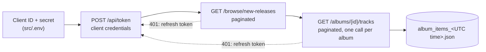

<h1 align="center">Spotify Batch Data Processing</h1>

<p align="center">
  A small batch pipeline that pulls Spotify's new album releases and their tracks from the Web API and saves them as JSON.
</p>

<p align="center">
  
  
  <a href="LICENSE"></a>
</p>

The project covers the basics of batch extraction from a REST API: OAuth 2.0 authentication, pagination, token refresh and a look at rate limits. The notebook walks through each step with live API calls, and `src/` holds the pipeline as plain scripts. The extracted data is meant as a starting point for later music analytics or recommendation work.

## How it works



1. `authentication.py` gets an access token with the client credentials flow. Tokens last 3,600 seconds.
2. `endpoint.py` pages through the [new releases](https://developer.spotify.com/documentation/web-api/reference/get-new-releases) endpoint, then through the [album tracks](https://developer.spotify.com/documentation/web-api/reference/get-an-albums-tracks) endpoint for each album. Both functions follow the `next` URL until it is empty, and ask for a new token when a request returns 401.
3. `main.py` runs the two steps and writes one JSON file that maps each album ID to its list of tracks.

## A run from the notebook

The notebook was run against the live API in September 2025. The new releases endpoint returned 100 albums in five pages of 20, with both pagination methods:

```text
Executed request with URL: https://api.spotify.com/v1/browse/new-releases?offset=0&limit=20.
Executed request with URL: https://api.spotify.com/v1/browse/new-releases?offset=20&limit=20.
Executed request with URL: https://api.spotify.com/v1/browse/new-releases?offset=40&limit=20.
Executed request with URL: https://api.spotify.com/v1/browse/new-releases?offset=60&limit=20.
Executed request with URL: https://api.spotify.com/v1/browse/new-releases?offset=80&limit=20.
```

It also sent 200 requests to the same endpoint with a 0.1 s pause between them. The average time between successful requests was 0.55 s.

## Pagination

The notebook implements two ways to walk through the pages:

- **Offset-based.** Compute the next page yourself from `offset` and `limit`, and stop once you reach `total`. It gives full control over which pages you fetch.
- **URL-based.** Follow the `next` URL the API returns until it is `null`. It is simpler, and it is what the pipeline in `src/` uses.

## Rate limits

Spotify applies a rate limit over a rolling 30-second window and answers with status 429 when you go over it. The notebook measures the request timing and lists the usual practices (spacing requests, exponential backoff). The pipeline in `src/` does not retry on 429 yet; it only handles expired tokens.

## Run it

1. Create an app in the [Spotify Developer Dashboard](https://developer.spotify.com/dashboard) with the Web API enabled. Any redirect URI works for this flow; the notebook uses `http://127.0.0.1:3000`.
2. Copy its client ID and client secret into `src/.env`:

   ```
   CLIENT_ID=your_client_id
   CLIENT_SECRET=your_client_secret
   ```

3. Install the dependencies and run the pipeline from `src/`, where it looks for `.env`:

   ```bash
   git clone https://github.com/anyantudre/spotify-batch-data-processing.git
   cd spotify-batch-data-processing
   pip install requests python-dotenv spotipy
   cd src
   python main.py
   ```

The output lands in `src/album_items_<YYYYMMDD_HHMMSS>.json`. `.env` is git-ignored, so your credentials stay out of the repository.

The last section of `instructions.ipynb` shows the same extraction with the [Spotipy](https://spotipy.readthedocs.io/) SDK.

## Repository layout

```
├── instructions.ipynb   # step-by-step walkthrough with live API calls
└── src/
    ├── authentication.py  # access token and auth header
    ├── endpoint.py        # paginated calls with token refresh
    └── main.py            # the batch pipeline
```

## Next steps

- Store the results in a database (PostgreSQL or MongoDB) instead of JSON files.
- Add retries with backoff for 429 responses.
- Package the pipeline with Docker and add CI.

## Credits

The structure follows the batch-processing lab of the [DeepLearning.AI Data Engineering](https://www.deeplearning.ai/courses/data-engineering/) course. Data comes from the [Spotify Web API](https://developer.spotify.com/documentation/web-api) and is subject to Spotify's developer terms.

The code is released under the [MIT License](LICENSE).
